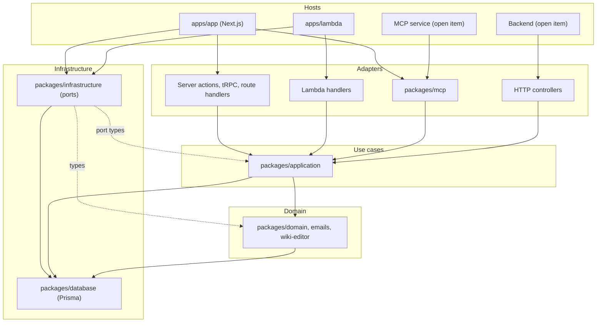

# Architecture

This document tells where the code lives and the rules that keep the direction. Update it when a package, a layer or a rule changes.

## Layout

The monorepo (`pnpm-monorepo`) has two groups of workspace packages.

### Hosts (`apps/*`)

A host is a deployable program. It owns its runtime, its configuration and its entry points.

| Host | Runtime | Role |
| - | - | - |
| `apps/app` | Next.js on Vercel | The web app: pages, server actions, tRPC, route handlers, the login (next-auth), the OAuth authorization server and the MCP endpoint |
| `apps/lambda` | AWS Lambda | Automations and the notification router: `email-function`, `frequent-automations`, `midnight-automations`, `notification-router`, `scrape-discord-events` |
| `apps/collab` | Node.js container | The realtime backend of the wiki (Hocuspocus) |
| `apps/scripts` | Node.js | One-off maintenance scripts |
| `apps/playwright` | Node.js | The end-to-end test suite with its own stack |

### Shared packages (`packages/*`)

| Package | Layer | Content | Depends on |
| - | - | - | - |
| `database` | infrastructure | The Prisma schema, the migrations and the generated client | — |
| `domain` | domain | The rules and helpers that more than one host uses: the permission model (`src/permissions`), the notification vocabulary (`src/notifications`) and the rules of each feature (one folder in `src/` per feature) | `database` (types) |
| `emails` | domain | The email templates | — |
| `wiki-editor` | domain | The Tiptap schema of the wiki content, text extraction, the Markdown renderer and parser | — |
| `application` | use cases | The use cases: one read or one write of a feature, with the permission checks, the audit events and the notifications inside. The actor, the application context and the typed errors. The OAuth use cases. See the [package README](../pnpm-monorepo/packages/application/README.md). | `database`, `domain`, `wiki-editor`. Never `infrastructure` or `mcp`. |
| `infrastructure` | infrastructure | The shared implementations of the ports of `application`: the Prisma audit writer, the EventBridge client, emitter, notification trigger and email requester, the Discord gateway, the collab client of the wiki editor and the S3 storage (the port [`FileStorage`](../pnpm-monorepo/packages/application/src/ports/storage.ts)). See the [package README](../pnpm-monorepo/packages/infrastructure/README.md). | `application` (the port types), `domain` (types), `wiki-editor` (the types of the collab tokens), `database`, the AWS SDK |
| `mcp` | interface adapter | The MCP server: the tool registry, the tools, the request handler with the bearer verification. See [mcp-server.md](./mcp-server.md). | `application`, `domain`, `database` |

Three callers use the use cases of `application`: the Next.js app, the MCP server (`mcp`, which the app mounts at `/api/mcp`) and the Lambda functions. Each caller has a composition root that builds its `ApplicationContext`.

### Inside the Next.js app

`apps/app/src/modules/<feature>/` holds the code of a feature: `queries/` (reads), `actions/` (server actions, the writes), `components/`, `utils/`. `apps/app/src/app/` holds the routes and the pages, which compose the modules.

Four modules are adapters of the packages, not features:

- `modules/application`: the composition root. `getApplicationContext()` builds the one context of the app. `getMcpApplicationContext()` gives the same ports with an audit writer that marks the events of the MCP endpoint. The audit port comes from `infrastructure`. The ports `notifications`, `email`, `discord`, `collab` and `storage` also come from `infrastructure` (the notification trigger and the email requester, which send their events through the EventBridge emitter of the app, the gateway with the bot token of the app, the client of the collab server, which is null without the URL and the secret of the collab server, and the S3 storage of the uploads, which is null without an endpoint). The port `images` is the `sharp` reader of the app. `sharp` is not in the packages or in the Lambda bundles, thus the Lambda functions give null. The port `prisma` is the client of `@sam-monorepo/database`. The other ports come from the modules of the app (logging, tracing, changelog, URLs, signing key). `toActor(session)` maps the next-auth session to the actor of the use cases, and `getRequestActor()` gives the actor of the current request to the pages and queries. Two helpers map the typed errors to action responses and to `forbidden()` / `notFound()`.
- `modules/oauth`: the consent page, the token and revocation endpoints and the metadata documents.
- `modules/mcp`: the `/api/mcp` route.
- `modules/mcp-settings`: the MCP app `/app/mcp` (the connected clients with their names and their tools).

Each feature module has a thin wrapper per query or action: it builds the actor from the session, calls the use case, and does the app-specific parts (React `cache()`, `FormData` parsing, translations, `refresh()`, `forbidden()`). The standard action wrapper is `createUseCaseAction()` of the composition root.

**The Prisma rule.** Only the composition root (`modules/application`) and the auth zone (`modules/auth/server`: the next-auth adapter and the session callback) use the Prisma client. The ESLint configuration object `use-cases-only` in `apps/app/eslint.config.mjs` enforces this in all of `src/**`: it forbids the `prisma` client and the `PrismaClient` class of `@sam-monorepo/database` and the package `@prisma/client`. Types from `@sam-monorepo/database/client` and enums from `@sam-monorepo/database/browser` are permitted. The tRPC context has no Prisma client (the procedures call use cases), and the path alias `@/db` has no file. The typecheck of the app fails on `ctx.prisma` and on an import of `@/db`.

### Inside the Lambda functions

The composition root is `apps/lambda/src/common/createApplicationContext.ts`. It uses the audit writer and the EventBridge adapters of `infrastructure` (the notification trigger and the email requester). The context has the no-op tracer of OpenTelemetry, because the functions register no tracer provider: X-Ray covers the handlers and the jobs, and the spans of the use cases are lost. The context has no changelog, no collab server, no image reader and no signing key. Only `midnight-automations` gets file storage: it builds the S3 storage when the four S3 parameters exist, and without them the storage is null and the sweep of the uploads skips.

`midnight-automations`, `frequent-automations` and `scrape-discord-events` (with the Discord gateway) call the composition root. Each job is a use case of `application` that `createJobFactory` runs and keeps in its own X-Ray segment. `email-function` does not call the composition root.

`notification-router` calls the composition root once and gives the context to its handlers. The recipient rules (`notifications/recipients`) and the database steps of the delivery (`notifications/delivery`: the on-site rows, the web push subscriptions and their prunes) are in `application`. The Lambda function has the transports (the realtime channel and the web push service, with their retries), the wording of each notification type and the publishing. The recipient and delivery modules import the other modules of `application` by file, thus the bundle holds no wiki, editor or Markdown code.

The Lambda functions hold only host code: the composition root (`common/createApplicationContext.ts`, `common/applicationContextEnvironment.ts` and `common/createJob.ts`), the logger, X-Ray, the parameters, `runJobsInIsolation`, DynamoDB and the transports. Their unit tests cover only this host code (the logger, the job runner and the New Year wordings).

**The Prisma rule.** Only the composition root uses the Prisma client. The Lambda functions have no ESLint configuration, thus the test `apps/lambda/src/boundaries.test.ts` enforces the rule: it fails when another file mentions `prisma`, `PrismaClient` or `@prisma/client`. Type imports of the models from `@sam-monorepo/database` are permitted. The same test fails on an integration test in the Lambda functions, because all integration tests of the automations are in `application`.

### Tests

See the [Tests section of the application README](../pnpm-monorepo/packages/application/README.md#tests) for the unit tests and the integration tests. The checks of the rules in this document are part of the lint, test and typecheck jobs of `.github/workflows/validate-app.yml`.

## The dependency rule

The direction is a pragmatic reading of Clean Architecture. The rules of the organization and the use cases of the system are independent of the hosts. A host is a thin adapter: it authenticates, builds the actor and the context, calls a use case, and shapes the response for its transport.

Dependencies point downwards only. The exceptions are the dotted edges: `infrastructure` imports the port types of `application` and the types of `domain` and `wiki-editor`, so that each host can pass the implementations to the use cases. A package never imports a host. `application` never imports `infrastructure`, `mcp` or `next`. `domain` never imports `application`.

Each package except `database` and `emails` (they have no test runner) has the test `src/boundaries.test.ts`. The test fails on an import of a host, of a package that the package must not use, of `next`, `react`, `server-only` or of a module of the app (`@/…`). It also fails when the `@sam-monorepo/*` entries of the `package.json` are not exactly the column "Depends on" of the table of the packages.

### The layers

- **Domain** (`domain`, `emails`, `wiki-editor`): the rules, without other I/O than the database. The packages create no database client and read no environment. A function that reads or writes the database takes the client or the transaction of its caller, for example a row lock or a transaction step. Prisma types and selects are permitted. `wiki-editor` is a separate domain-level package because it depends on Tiptap and has a browser entry (`helpers`): inside `domain` it would pull Tiptap into the Lambda functions and the collab server. `emails` is a separate package because email templates are presentation, not rules: a use case asks the context to send a notification, and the template renders it.
- **Use cases** (`application`): `(context, actor, input) => output`, with the context and its ports as the [package README](../pnpm-monorepo/packages/application/README.md) describes them. The use cases check the permissions, thus a new host cannot forget a check. The use cases call Prisma directly; there are no repository ports. This is the one intentional break of the dependency rule.
- **Adapters**: the server actions and tRPC procedures of the Next.js app, the MCP tools and request handler, the Lambda handlers. They parse the transport-specific input, call the use cases and map the typed errors.
- **Infrastructure** (`database`, `infrastructure`): the Prisma schema and client, and the shared implementations of the ports. Each host composes the implementations in its composition root.
- **Hosts**: the deployables. Each host has one composition root that builds its context. The logger and the tracer are per host: the app logs in `after()`, and the Lambda functions log to the console.

## How to add a piece of logic

1. Put the pure rules into `domain` (or the fitting domain package) if the Lambda functions or the collab server could use them.
2. Write the use case in `application/src/<feature>/`: the Zod input schema next to it, an explicit plain output, the permission checks with `requirePermission`, the audit events and the notifications through the context.
3. Write the app query or action as a thin wrapper: the actor from the session, the use case call, the app-specific response.
4. Write no Prisma call in a host outside its composition root: the ESLint rule `use-cases-only` refuses it in the Next.js app, and the test `apps/lambda/src/boundaries.test.ts` refuses it in the Lambda functions.
5. Test the behavior through the end-to-end tests. Add an integration test in `application` only for critical logic without one.

## Open items

- **The MCP endpoint as a service of its own.** A service that imports `mcp` and `application` and builds its own context. The gain is independent scaling and deployment.
- **A dedicated backend.** A backend with Next.js as a backend-for-frontend is necessary only when a second frontend or a scaling need exists.
- **OpenTelemetry in the Lambda functions.** The functions use the no-op tracer, and X-Ray covers the handlers and the jobs, thus the spans of the use cases are lost there. The X-Ray SDK is in maintenance mode.
- **The upload table and the restricted wiki pages.** A user without `upload;manage` sees the titles, the slugs and the event ids of restricted or trashed wiki pages that hold the own image. The table must replace each usage of a page that the user cannot read with a redacted entry, with one access check per scope and not one query per row.
