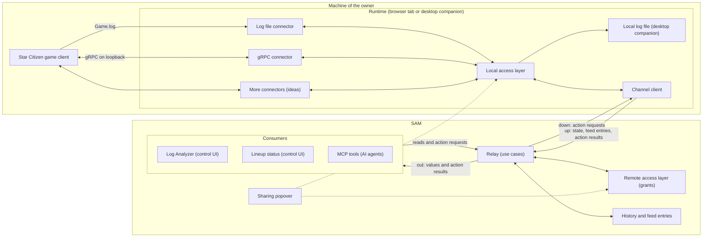
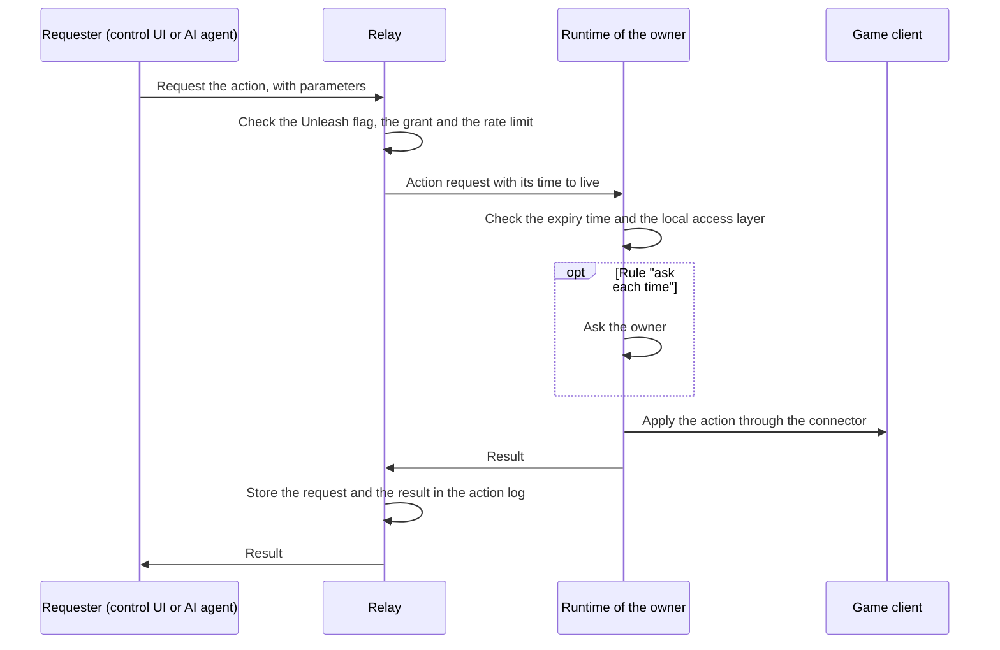

# Remote Control Program

> [!NOTE]
> This document describes the architecture of the Remote Control Program. In 2026-11, the implementation is in progress: the steps 1 and 2 of the [migration](./migration.md#order-of-the-steps) are done, and step 3 builds the desktop companion with the log file connector. [Migration](./migration.md) describes the steps from the current state of SAM to this architecture. When a plan or the code changes a decision, update this document. "Remote Control Program" is a working title, and the code can use it (see [Decisions](#decisions)).

The Remote Control Program connects the Star Citizen game client on the machine of a user with SAM. It moves the state of the game client (for example the health, the location or the log entries) to SAM. It moves actions from SAM to the game client (for example "open the doors of my ship"). The user decides what leaves the machine, who in SAM can read it, and which actions the game client applies.

The control UIs are the [Log Analyzer](#log-analyzer) and the [lineup status](#lineup-status).

Documents in this folder:

| Document | Content |
| - | - |
| This document | The architecture: the terms, the principles, the parts and the decisions. |
| [The gRPC interface of the game client](./grpc-interface.md) | All that we know about the gRPC server of the game client: the setup, the transport, the calls, the messages, the actions and the test results. |
| [Migration](./migration.md) | The steps from the current state of SAM to this architecture, and the decisions that apply only to the migration. |

## Goals

- One structure for all interfaces to the game client: the log files, the gRPC interface and interfaces that come later.
- Independent parts. A new connector, a new capability or a new control UI does not change the other parts.
- One Unleash flag turns off the full Remote Control Program (see [Switches](#switches)).
- The user decides at two levels: what leaves the machine, and who in SAM can read it or request actions.
- Access can have a time limit.
- SAM keeps the uploaded data permanently, so that control UIs can show the history and statistics (see [History](#history)).
- AI agents can read state and request actions through the [MCP server](../mcp-server.md).

## Non-goals

- No control of the computer outside the game. The Remote Control Program applies only named game actions from a catalog. It never applies free-form keyboard input, mouse input or text from SAM.
- No queue of actions for a machine that is offline.
- No live access for admins without a grant of the owner (see [Decisions](#decisions)).
- No other games.

## Terms

| Term | Meaning |
| - | - |
| Owner | The citizen whose game client supplies the state and applies the actions. |
| Runtime | A program on the machine of the owner. It contains the connectors, the local access layer and the channel client. Examples: the browser runtime (a SAM tab), the desktop companion. |
| Interface | A way of the game client to give state or to accept actions. Examples: the log files, the gRPC interface. In this document, "interface" always means an interface of the game client. |
| Connector | A module of a runtime that uses one interface. It supplies capabilities. Examples: the log file connector, the gRPC connector. |
| Capability | A typed and versioned contract for one type of data or one action. All parts share one catalog of capabilities. There are three kinds: state, feed and action. |
| Channel | The transport of a capability between a runtime and the relay, or between the relay and a consumer. It has a direction and a timing (realtime or periodic). |
| Relay | The part of SAM that receives the data of the runtimes, stores it, applies the remote access layer, gives the data to the consumers and sends the action requests to the runtimes. |
| Local access layer | The rules in a runtime: which capabilities leave the machine, and which actions the runtime applies. |
| Remote access layer | The grants in SAM: who, other than the owner, can read the live data of a capability or request an action. |
| Live data | The current state, the realtime delivery, and the stored rows of the period of a grant while the grant is valid. |
| Grant | One decision of the owner in the remote access layer: a grantee, capabilities, operations and a validity period. |
| Consumer | A part of SAM that reads capabilities or requests actions: a control UI or an MCP tool. |
| Control UI | A user interface (UI) in SAM that shows capabilities or requests actions. Examples: the Log Analyzer, the lineup status. |
| Sharing popover | The one location in the UI of SAM where the owner controls the Remote Control Program. |

## Overview

The diagram shows the logical flow. The [Channels](#channels) section tells which transports carry the messages.

## Principles

Each part of the Remote Control Program obeys these rules.

1. **Capabilities decouple the parts.** A connector knows only the capabilities that it supplies. A consumer knows only the capabilities that it uses. A connector and a consumer never know each other.
2. **All is off by default.** A capability leaves the machine only after the owner turns it on in the local access layer. A different citizen reads it live only with a grant. For the stored data, see principle 5.
3. **The local access layer is the upper limit.** SAM cannot change the rules of a local access layer. A grant cannot give access to data that does not leave the machine, or to an action that the runtime refuses.
4. **The access is the intersection of all layers.** See [Effective access](#effective-access).
5. **The remote access layer applies to the live data, at each delivery and at each read.** A subscription does not keep an access. When a grant expires or the owner revokes it, the live data stops within seconds. The grants do not apply to the stored data: each consumer checks its own permission for the history (decision 30).
6. **The use cases enforce the remote access layer.** The relay is a set of use cases in `application`, like the permission checks (see [Architecture](../architecture.md#the-layers)). Thus a new consumer cannot forget a check. Only the relay sends messages to the realtime service. A runtime never publishes to it directly.
7. **Actions are named and typed.** An action is an entry in the catalog with a schema for its parameters. A connector never applies free-form input from SAM. A game action that the catalog does not contain cannot be requested.
8. **Actions expire.** Each action request has an expiry time. A runtime does not apply an expired request (result `expired`). When no runtime of the owner can apply a request, the relay answers immediately (result `unavailable`).
9. **Each action request goes into the action log.** The relay stores each action request with its result in the database and writes audit events. The desktop companion also writes a local log file (see [Action log](#action-log)).
10. **A released capability version does not change.** To change a capability, release a new version. This is the same rule as for the audit event types and the patterns of the Log Analyzer (see [AGENTS.md](../../AGENTS.md)).
11. **One definition for all languages.** The browser runtime and the relay use TypeScript. The desktop companion uses Rust (see [Decisions](#decisions)). Thus a connector can have two implementations, for example the log file connector. The catalog, the patterns of the log file, the rule for the IP addresses (decision 22) and the protocol of the relay service (see [Protocol](#protocol)) have one definition, and both languages use it. Shared test data (for example log lines and gRPC messages with the expected results) makes sure that each implementation gives the same result.
12. **The connectors parse on the machine.** Only capability data leaves the machine, never a full log file or a full stream.
13. **Each stored value has its context:** the runtime, the connector with its version, and the capability version.
14. **A connector never depends on a different connector.** Each connector supplies only what it knows itself. Thus each connector works alone, and the owner can turn off each connector without effects on the data of the other connectors.
15. **Connectors upload raw values. Consumers derive.** A connector uploads the values as the interface gives them. It changes them only for the access layers and for privacy (for example a lower rate, or a raw line without IP addresses). Each consumer derives the values that it needs (for example the Live-Status of the Log Analyzer).

## Runtimes

| Runtime | Location | Connectors | Limits |
| - | - | - | - |
| Browser runtime | A SAM tab in the browser | Log file | Runs only in Chromium browsers (the File System Access API), and only while a SAM tab is open. A tab in the background continues to work. Cannot use the gRPC interface (see [Browser access](./grpc-interface.md#browser-access)). After a restart of the browser, the owner must give the file access again with a click. |
| Desktop companion | A Rust program on the machine (Windows and Linux) | Log file, gRPC | The owner must download it (a portable program, see decision 20). It needs its own login and updates. |

### Browser runtime

- The browser runtime runs on all pages of SAM, not only on the page of a control UI. Thus the sharing continues when the owner opens a different page.
- One browser has one active browser runtime for each citizen, also with more than one SAM tab. The tabs of the citizen elect one runtime with the Web Locks API. The other tabs are only consumers.
- A change of the active tab makes no gap in the upload. When the tab of the runtime closes or crashes, the next SAM tab of the same citizen continues the live period (see [Local access layer](#local-access-layer)), when the previous runtime read live not more than 30 seconds before.
- The browser keeps the state of the browser runtime for each citizen: the settings, the live periods and the handle of the log folder. A citizen who logs in after a different citizen in the same browser does not get this state. Thus a runtime never uploads the entries of a different citizen as the own entries. A logout stops the runtime of the citizen in all tabs, without a continuation.
- The settings of the browser runtime are in the sharing popover (see [Sharing popover](#sharing-popover)): the autostart, the log folder and the local access layer.
- With the autostart, the browser runtime starts on each SAM page. When the browser needs a click to give the file access again, the sharing popover tells it (see [Sharing popover](#sharing-popover)).
- SAM supplies the code of the browser runtime. Thus its local access layer protects against other citizens and against mistakes, but not against a compromised SAM deployment.

### Desktop companion

- A separate Rust program in a separate repository (decisions 2 and 32). Its UI uses GPUI (decision 33). Its local access layer protects also against a compromised SAM deployment, because SAM cannot change the code or the rules on the machine. This is true only when SAM cannot deliver a changed program or changed rules:
  - Each update has a signature with a key that only the release process holds, not the SAM deployment. The desktop companion verifies the signature before it installs an update. This signature is separate from a code signing certificate of Windows (decision 25).
  - The catalog of the actions is compiled into the program. SAM cannot change it at runtime.
- Only one copy of the program runs for each folder of settings (a lock). Two copies would use the same refresh token, and the reuse of a refresh token revokes the OAuth grant (see [OAuth design](../mcp-server.md#oauth-design)).
- It supports Windows and Linux. It is a portable program without an installation (see decision 20). The releases, the updates and the tray icon must work on both operating systems.
- It connects directly to SAM, not through a browser tab. Thus it works without an open tab.
- It signs in with OAuth 2.1 as a native client of the authorization server of SAM (see [OAuth design](../mcp-server.md#oauth-design)): the authorization code grant with PKCE and a loopback redirect.
  - The Remote Control Program is a resource of the authorization server, with its own audience (resource indicators, RFC 8707) and its own scope. With its access token, the desktop companion gets the connection tokens from the app. Only the desktop companion of SAM can get this resource (decision 35).
  - The consent requires `remoteControlProgram;use`, not `mcp;use`.
  - The client id of the desktop companion is a Client ID Metadata Document on a URL of SAM (see [Resources](../mcp-server.md#resources)).
  - The refresh token is in the credential store of the operating system (decision 36).
- It contains the log file connector next to the gRPC connector. The log file connector supplies `log_entries`, and uploads them only when the local access layer permits it.
- Its UI controls the local access layer. It asks the questions of "ask each time". It shows no data of the game: the control UIs in SAM show the data.

### Announcement

The owner can use more than one runtime at the same time. Each runtime has an id. When a runtime connects, it announces to the relay:

- its id and its kind,
- its connectors, and the capabilities and versions that they can supply,
- a summary of its local access layer.

The relay keeps the announcement while the runtime is online (see [Presence](#presence)). The sharing popover and the control UIs use it to tell why the own data is missing (see [Control UIs](#control-uis)).

## Connectors

| Connector | Interface of the game client | Capabilities (examples) | Runtimes |
| - | - | - | - |
| Log file | `Game.log` and the old log files | `log_entries` | Browser runtime, desktop companion |
| gRPC | The gRPC interface | `player_vitals`, `ship_status`, the named game actions | Desktop companion |

- A connector supplies capabilities and applies actions. It does not know the channels, the relay or the consumers.
- A connector uploads raw values and derives nothing (principle 15). Example: the log file connector uploads the matched lines. The Log Analyzer derives the Live-Status from them.
- A connector reads its interface at its own rate, for example the log file each 10 seconds. This rate is internal. It is not the timing of a channel.
- More connectors are ideas (see [Ideas](#ideas)).

### The gRPC connector

The [gRPC interface of the game client](./grpc-interface.md) has these results for the architecture:

- No browser can use the interface. The test confirmed it (see [Browser access](./grpc-interface.md#browser-access)). Thus the gRPC connector runs only in the desktop companion.
- The game client supplies named actions (for example `v_open_all_doors`) and applies them itself. Thus the actions of the Remote Control Program need no simulated input. The catalog maps an action capability to the names of the game actions. Actions such as `v_self_destruct` and `v_eject` stay out of the catalog.
- One message of the interface contains data of different sensitivity (for example the seat and the wallet balance). The connector removes each field that no permitted capability needs before the data leaves the machine.
- The interface gives no game version. Thus the rows of the gRPC connector have no game version for now (see decision 17).
- The gRPC interface is the source of truth for the state of the game client. `Game.log` does not always show the actual state. Thus the states come from the gRPC connector. The log file connector supplies only the feed of the log entries.

The [requirements for the gRPC connector](./grpc-interface.md#requirements-for-the-grpc-connector) are in the document of the interface.

## Capabilities

All parts share one catalog of capabilities: the runtimes, the relay and the consumers. An entry of the catalog has these fields:

| Field | Meaning |
| - | - |
| Id | A name in lowercase snake_case, for example `player_vitals`. All versions have the same id. |
| Version | An integer. A released version does not change. |
| Kind | State, feed or action. |
| Schema | The Zod schema of the value or of the parameters of the action, with a limit for each array and each string. For an action, also the schema of the result. |
| Timing | For a state or a feed: realtime or periodic, and the minimum interval between two updates. |
| History interval | For a state: the minimum time between two rows of the history (see [History](#history)). |
| Stale time | For a state: the age after which a consumer shows the value as stale. |
| Sensitivity | Normal or high (for example the location or the wallet balance). It is a fact for the choice of the defaults. The sharing popover shows no warning for it. |
| Risk | For an action: low or high. For an action with high risk, the default rule of the local access layer is "ask each time". |
| Expiry | For an action: the time after which a runtime does not apply the request (result `expired`). |
| Game actions | For an action of the gRPC connector: the names of the game actions that it uses. |

The kinds:

- **State:** a value that changes, for example the health. The latest value is the current state. The relay keeps the history of the values.
- **Feed:** entries that the relay appends, for example the log entries. Each entry has a time and a unique key. The relay uses the key to remove duplicates (for `log_entries`, see [Log Analyzer](#log-analyzer)).
- **Action:** a request from a consumer to the game client, and a result from the runtime.

When more than one runtime or connector supplies the same state, one rule decides which value applies:

1. The catalog gives a priority of the connectors for each capability. The value of the connector with the higher priority applies. Example: gRPC before a later screen connector, because the gRPC interface gives the actual state of the game client.
2. Inside the same priority (for example two runtimes with the same connector), the newest observation applies.
3. When the value of the higher priority is stale, the value of the next priority applies.

Examples (not a final catalog):

| Capability | Kind | Connectors |
| - | - | - |
| `log_entries` | Feed | Log file |
| `player_vitals` | State | gRPC |
| `ship_status` | State | gRPC |
| `wallet_balance` | State, high sensitivity | gRPC |
| `ship_doors` | Action | gRPC (`v_open_all_doors`, `v_close_all_doors`) |
| `emote` | Action | gRPC (the `emote_*` game actions) |

## History

The relay keeps all uploaded data permanently: the history of each state and all feed entries. Control UIs can use it for the history and for statistics.

- The relay stores the history of the states in TimescaleDB, an extension of PostgreSQL (see [Decisions](#decisions)). The feed entries stay in normal tables (for example `LogAnalyzerEntry`).
- Each accepted value of a state is one new row. The relay never changes or deletes a row.
- The history interval of the catalog limits the rows of a value that changes all the time (for example the heart rate). The compression of TimescaleDB keeps repeated values small.
- The relay keeps the current state separately: one entry for each owner, capability and connector, which each upload replaces. The history interval limits only the history, not the current state. A consumer reads the current state with the rule of [Capabilities](#capabilities) for the priority of the connectors.
- Continuous aggregates of TimescaleDB can supply the statistics. A statistic uses only the data that the consumer can read.
- The history tables are normal models in the Prisma schema, with the time in the primary key. The SQL migrations add only what Prisma does not know: `create_hypertable`, the compression and the continuous aggregates. A table outside of the Prisma schema is not safe, because `prisma db push` and `prisma migrate dev` compare the database with the schema and can drop the table. The shadow database of Prisma also needs the extension.
- Each row records the runtime, the connector with its version and the capability version (principle 13). Thus a statistic can tell which contract supplied a value.
- The rows have no game version for now (see decision 17). When the gRPC interface supplies the game version, the gRPC connector adds it to its new rows. The older rows stay without a game version.
- The grants do not apply to the history (principle 5). A grant that ended or that the owner revoked does not change the stored data.
- Each consumer that shows the history of other citizens names the permission for it, and checks this permission at each read. It also decides the minimum age of the rows: without it, the newest rows are live data without a grant. A consumer without such a permission shows no history of other citizens. Admin mode replaces the permission (decision 4).
- The local access layer decides which data the relay stores. The owner cannot withdraw or delete stored data (decision 12). The sharing popover tells the owner this before the first upload.

## Channels

A channel is the transport of a capability. The catalog gives the timing. The runtime and the relay select the transport.

| Direction | Realtime | Periodic |
| - | - | - |
| Up: runtime to relay | State and feed entries within seconds. The runtime sends a maximum of one update for each capability in the minimum interval. | A batch at a fixed interval, for example each minute. |
| Down: relay to runtime | Action requests. | Not for actions: an action that waits for the next interval is stale. |
| Out: relay to consumer | New values, new entries and action results within seconds. | Polling, for example each 60 seconds. |

- An action is a pair of messages: the request goes down, and the result goes up.
- Up and down: each runtime keeps one WebSocket connection open to the relay service (see decision 14). The connection carries both directions, for the browser runtime and for the desktop companion.
- Out: the relay service sends the messages to the consumers through Soketi with the Pusher protocol (`apps/app/src/modules/pusher`). Each viewer has a private channel of the Remote Control Program (`private-remote-control-program-<citizen id>`). The relay checks the grants for each message and sends one copy to each viewer with access.
- The channel of the Remote Control Program is separate from the channel of the notifications (`private-citizen-<citizen id>`). An admin who assumes a user gets the notifications of the user, but must not get the data of the Remote Control Program (decision 4). Thus the app refuses the subscription of the channel of the Remote Control Program in such a session.
- Out: the relay collects the changes for each viewer and sends a maximum of one message to each viewer in a short interval (for example 2 seconds). Example: a lineup with 30 citizens, who all watch the lineup and send one update each second, gives 900 messages each second without this rule, and 15 messages each second with it.

### Delivery to the consumers

- A control UI tells the relay (through the app) which owners and capabilities it watches, with a lease that it renews. The relay sends messages only to the viewers that watch. Thus a grant with the grantee kind "Everyone" or "Role" does not send a message to each citizen with access. The lease also tells the admin mode of the viewer at its last renewal. The relay checks the admin role at each delivery. Admin mode counts while one lease of the viewer has it, because all control UIs of a viewer share one channel. Thus its end in one browser applies when the last lease with admin mode expires.
- When a control UI opens, it reads a snapshot of the current values with a cursor. Then it gets the changes through Soketi. After a reconnect of Soketi, it reads the changes since its cursor.
- A batch for a viewer stays below the size limit of a Soketi message. A larger batch goes into more messages.
- The active tab of the browser runtime gives its local data to the other tabs of the same citizen in the same browser through a BroadcastChannel.

## Relay

- The relay is a set of use cases in `application`: publish state, append feed entries, read the current state, the history and the feeds, announce a runtime, request an action, report an action result, manage grants, manage access requests.
- The relay service is a separate host, outside of the Next.js app and Vercel (see decision 14). It keeps the WebSocket connections of the runtimes and calls the use cases. It builds its own application context, like each host (see [Architecture](../architecture.md#the-layers)).
- The app and the MCP server call the read use cases and the grant use cases directly. They send an action request to the relay service through an internal HTTP endpoint. The endpoint answers immediately with the id of the request. The result arrives through Soketi in the private channel of the requester, and it is in the action log. The endpoint accepts only requests with a secret or a signed token of the app, like the collab server.
- Each use case validates its input with the schema of the catalog.
- Each use case applies the Unleash flag of the Remote Control Program and the remote access layer.
- The relay stores the history and the feed entries (see [History](#history)).
- The relay sends an action request to one runtime of the owner that is online and supplies the action. When more than one runtime supplies it, the priority of the connectors decides. The relay sends the request only through the connection of this runtime.
- The relay applies limits (see [Limits](#limits)).
- The relay writes audit events for the grants, the access requests, the action requests and the action results. It writes no audit event for each upload. For the uploads, it writes counts for each runtime connection or for each hour, not for each batch. Thus the realtime uploads do not make `AuditEvent` large (see decision 7). New audit event types obey the rules in [AGENTS.md](../../AGENTS.md).

### Action lifecycle

The result of a request is one of these:

| Result | Meaning |
| - | - |
| `applied` | The connector applied the action. |
| `refused` | The relay or the runtime refused the request. The result gives the reason: the Unleash flag, the remote access layer, a rate limit, the local access layer or the owner. |
| `unavailable` | No runtime of the owner is online and supplies the action. |
| `expired` | The expiry time passed before the runtime could apply the action. This includes "ask each time" without an answer. |
| `failed` | The connector tried to apply the action, but the game client did not accept it. The result contains the reason of the game client. |

### Protocol

The runtimes and the relay service use one protocol over the WebSocket connection. It is a part of the shared definitions (principle 11), because TypeScript and Rust implement it. [protocol.ts](../../pnpm-monorepo/packages/domain/src/remoteControlProgram/protocol.ts) defines the messages, the reasons to close a connection and their close codes.

- Each message has an envelope: the type of the message, an id, the version of the protocol and the content.
- The handshake: the runtime sends the version of the protocol and its own version. The relay service refuses a version that is older than a minimum version. The runtime then tells the owner to update.
- The version of the handshake applies to the full connection. The relay service accepts and sends a message type only on a connection of the version that added the type, or newer. Version 2 adds the request for the keys of the own feed entries (decision 34).
- The relay service acknowledges each upload. The runtime sends an upload again until it gets the acknowledgement.
- A resend is a new message with a new id. Thus the relay cannot remove duplicates with the id of a message. Each feed entry has a unique key (for `log_entries`, the hash of the entry, see [Log Analyzer](#log-analyzer)), and the relay stores an entry with a key that it already has only once. Each action request has a unique key too, and the relay ignores a second request with the same key. Thus a resend after a reconnect makes no duplicate.
- The runtime keeps the results of its last action requests and sends them again after a reconnect. A late result replaces an `expired` in the action log. Thus an applied action does not stay `expired`.

### Connection and tokens

- A runtime connects with a short-lived connection token (for example 120 seconds), and renews it over the open connection, like the collab tokens of the wiki. The relay service closes a connection without a valid token.
- The runtimes get the connection token from the route `POST /api/remote-control-program/connection-token` with the body `{ "runtime_id": "<uuid>" }`. The answer is `{ "token", "expires_at", "relay_url", "citizen_id", "handle" }` (`relay_url` is null when the app has no relay service). The browser runtime uses the session of the app. The desktop companion sends its OAuth access token in the header `Authorization: Bearer <token>`, and never a session: then the connection token contains the id of the OAuth grant and no admin mode. Status codes: `400` for a body or an `Authorization` header that is not valid, `401` for an access token that is not valid or whose grant is revoked (with a `WWW-Authenticate` challenge), `403` without the clearance of the app, a citizen or `remoteControlProgram;use`, `503` when the app has no signing key.
- The relay service accepts the runtime kind `desktop_companion` only with a connection token from an OAuth grant, and the kind `browser` only with a token from a session.
- The token tells whether admin mode was on in the app. The relay service applies it only to an admin. The end of admin mode applies at the next renewal, and at the latest when the relay service closes the connection without a renewal.
- When a runtime connects and at each renewal, the relay service checks the OAuth grant of the desktop companion and the ban of the user. Thus a revocation or a removed permission stops a connection at the next renewal (the close reason `access_denied`), and at the latest when the token expires.
- A ban also closes the connections of the relay service, next to the connections of Soketi and of the wiki editor.

### Presence

- The relay service runs as one instance for the start.
- It stores the announcement of each connected runtime in the database, with a lease. The runtime sends a heartbeat (for example each 15 seconds), and the relay service renews the lease. A runtime without a valid lease is offline.
- The app and the MCP server read the presence from the database. Thus they answer `unavailable` immediately.
- A runtime connects again after a random delay that grows with each failed attempt.
- A restart of the relay service closes the connections in a controlled way, and the runtimes connect again.

### Time

- Each value has two times: the time of the observation and the time of the arrival (from the relay). The relay replaces a time of the observation in the future with the time of the arrival. It does not limit how old an observation is, because the owner can upload older entries on an explicit request (decision 27).
- A log entry has the time of its raw line when the pattern has one. Only an entry whose pattern has no time of its own (`takesTimeOfPrecedingLine`) takes the time of the observation from the runtime.
- The gRPC frames contain no time. Thus the gRPC connector uses the time when it receives a frame.
- The grant windows, the stale time and the history use the time of the relay.
- An action request has a relative time to live (for example 10 seconds), not an absolute expiry time. Thus a wrong clock on the machine does not change the expiry.

### Limits

The relay service limits:

- the upload rate for each capability and runtime (the minimum interval of the catalog), also across reconnects,
- the uploaded entries of each owner in each hour,
- the `hello`s of each owner,
- the `heartbeat`s, the token renewals, the `announce`s and the requests for the own entry keys of each connection,
- the size of each message,
- the number of runtimes for each owner,
- the connections that wait for their `welcome` (the proxy limits the connections for each address),
- the number of access requests for each citizen,
- the action requests for each requester and action.

A runtime that breaks a limit gets an error. Repeated errors close the connection. A message that is larger than the limit closes the connection at once with the WebSocket code 1009 (message too big), before the relay service reads the message. The values are in `RELAY_LIMITS` in [catalog.ts](../../pnpm-monorepo/packages/domain/src/remoteControlProgram/catalog.ts). The values of the limits that only the relay service applies are in [rateLimits.ts](../../pnpm-monorepo/apps/relay/src/rateLimits.ts) and [relayServer.ts](../../pnpm-monorepo/apps/relay/src/relayServer.ts).

## Access layers

### Effective access

A consumer can read the live data of a capability of an owner only when all these conditions are true:

1. The Unleash flag of the organization permits the Remote Control Program.
2. The consumer has the permission to use the Remote Control Program (`remoteControlProgram;use`), and the permission of the control UI, if it has one (for example `logAnalyzer;read` for the Log Analyzer, see decision 24). Admin mode replaces both permissions (decision 4).
3. The consumer is the owner, or a valid grant of the owner gives the operation `read` on the capability to the consumer.
4. The local access layer of a runtime of the owner lets the capability leave the machine. Without this condition, there is no data.

A consumer can read the history of a capability only when the conditions 1 and 2 are true, and the viewer is the owner or has the permission of the consumer for the history (see [History](#history)).

A consumer can request an action of an owner only when the conditions 1 and 2 are true, and:

3. The consumer is the owner, or a valid grant of the owner gives the operation `request` on the action to the consumer.
4. A runtime of the owner is online and supplies the action, and its local access layer accepts the request.

### Local access layer

- Each runtime has one local access layer. The connectors do not have their own. Thus one rule applies to a capability, independent of the connector that supplies it.
- A rule for a state or a feed is "off" or "on". A rule for a feed can have a filter. Example: the log entry types that the owner shares. The filter exists only in the local access layer. A grant always covers a full capability (see [Decisions](#decisions)).
- A feed entry leaves the machine automatically only when a running runtime reads it live, while the rule is on and the runtime is not stopped. The entries from a time without a running runtime stay on the machine. Older entries leave only on an explicit request of the owner with a confirmation (decision 27). The details:
  - The runtime keeps the times in which it read live (the live periods) for 7 days. After a start, it uploads the entries of these periods that the relay does not have yet, for example the entries of a time without a connection to the relay.
  - When the runtime learns that the Unleash flag turned off the Remote Control Program, it removes all stored live periods. A change of the log folder also removes them. After the next start, only the entries that the runtime reads live from then on go up.
  - The values and their reasons are in [livePeriods.ts](../../pnpm-monorepo/packages/remote-control-program-runtime/src/localAccess/livePeriods.ts). The continuation after a change of the tab is in [Browser runtime](#browser-runtime).
- A rule for an action is "off", "ask each time" or "automatic". The rule also tells which requesters it accepts: only the owner, or also other citizens with a grant.
- The owner starts and stops a runtime only where it runs: the browser runtime in the sharing popover of this browser, and the desktop companion in its own UI. SAM does not start, stop or configure a runtime (decision 23).
- The runtime keeps its rules on the machine: in the browser storage, or in a file of the desktop companion. The relay never writes them.
- "Ask each time" shows the request to the owner. The browser runtime shows it in the sharing popover. The desktop companion shows it in a small window of the program. When the owner gives no answer before the expiry time, the result is `expired`.

### Remote access layer

A grant has these fields:

| Field | Meaning |
| - | - |
| Grantee | See the grantee kinds below. |
| Capabilities | One or more capabilities. |
| Operations | `read` for a state or a feed, `request` for an action. |
| Validity | A start time and an optional end time. The sharing popover gives presets: 1 hour, 2 hours, until the end of an event, no end. While a grant is valid, it gives access to the data from its validity period. The owner can set a start time in the past. |
| Revocation | The owner can revoke a grant at all times. It ends the live access, but not the access to the history through a consumer. |

The grantee kinds:

| Grantee kind | Who |
| - | - |
| Citizen | One citizen. |
| Role | All citizens with at least one of the selected roles, at the time of each access. A grant whose roles were all deleted gives no access. |
| Everyone | All citizens who can use the Remote Control Program. |
| Event participants | The participants and the managers of one SAM event, at the time of each access (see decision 16). The validity can follow the time of the event. |

- The owner needs no grant for the own data and the own actions. The local access layer still applies to the own actions.
- The AI agents (MCP clients) of a citizen act as this citizen (see [MCP Server](../mcp-server.md)). Thus a grant to a citizen also applies to the AI agents of this citizen, for `read` and for `request`. No layer has a separate setting for AI agents.
- A citizen without a grant can send an access request. The owner gets a notification and decides in the sharing popover.
- In the code, the grants of the remote access layer need a different name than the existing model `OAuthGrant` (for example `ShareGrant`).

## Sharing popover

- An item in the top bar (`apps/app/src/modules/shell/components/TopBar/`) and, on a mobile device, in the flyout of the action bar, where it opens a bottom sheet. In both places, it is left of the support button. It follows the notifications popover.
- It has a tab for each of these sections. Without a log folder, the popover opens with the start. Else it opens with the sub-tab of the browser. When a control UI opens the popover, it shows the tab that the control UI names, for example the sub-tab of the browser for the log folder. The tab of the runtimes is apart from the other tabs, because it contains the settings of the runtimes.
  1. **Start:** what the Remote Control Program is, and what the runtimes, the connectors, the consumer apps (the available and the planned ones), the grants and the stored data are, from the view of the owner. A matrix shows which runtime supports which connector. Links open the other tabs.
  2. **Grants:** the grants with their remaining time, a form for a new grant, and the open access requests.
  3. **Runtimes:** one sub-tab for each runtime. The popover shows no other browser of the owner.
     - **Browser:** the settings of the browser runtime in this browser (its state, the start and the stop, the autostart), and, below the heading "Connectors", one collapsible part for each connector with its rules of the local access layer (for the game logs: a closed part with the instructions, the log folder, the types, and a closed part for the upload of the older entries of a date range). A part is open at first only when the owner must do something in it. A note when the browser runtime needs a click (for example to give the file access again).
     - **Desktop Companion:** the connected desktop companions of the owner (from the presence: the time of the connection, the version and the active connectors; a connector is active when at least one of its capabilities leaves the machine), the sign-ins of the desktop companion of the owner, each with a sign-out, a link that opens the program when the owner has a sign-in (decision 37), and from step 5 of the [migration](./migration.md#order-of-the-steps) the download. SAM has no settings of the desktop companion: the owner changes them in the desktop companion (decision 23).
  4. **Action log:** the action requests to the runtimes of the owner, with their results (see [Action log](#action-log)). This includes the requests that the relay refused.
- The item of the popover, and the item "Apps" of the action bar, have a mark when the browser runtime needs a click. Thus the owner sees it also while the popover is closed.
- A control UI never has its own UI for access. When it needs an access, it opens the sharing popover with a prepared request. Examples:
  - The Log Analyzer asks the owner to select the log folder.
  - The lineup status sends an access request to a different citizen.
  - A control UI suggests that the owner shares a capability with the participants of an event.

## Action log

- The relay stores each action request with its result in the database: the time, the requester (the name, and the kind: person or AI agent), the action, the parameters, the decision of the remote access layer, the decision of the local access layer and the result. The runtime reports its decision and the result (see [Action lifecycle](#action-lifecycle)).
- Thus the action log also contains the requests that never reached a runtime.
- The sharing popover shows the action log of the owner.
- The browser runtime keeps no log of its own.
- The desktop companion also writes a local log file. This file is the record of the machine, also when the SAM deployment is compromised.

## Consumers

### Control UIs

- A control UI uses a consumer client of the app. The consumer client combines two sources: the browser runtime in the same browser, and the relay. A control UI does not know where a value comes from. Exception: the Log Analyzer shows for each entry whether SAM has it or only this browser.
- The own data of the browser runtime in the same browser needs no upload. Thus the Log Analyzer shows the own log without sharing. The data of the desktop companion reaches the browser only through the relay.
- A control UI can show the current state. It can show the history and statistics of other citizens only with its own permission for them (see [History](#history)).
- A control UI shows the age of each value, and marks a value as stale after the stale time.
- A control UI tells why the own data is missing: no runtime is online, no connector supplies the capability, or the local access layer blocks it. In step 2 of the [migration](./migration.md#order-of-the-steps), a viewer cannot read the announcements of other owners. Thus a control UI does not tell why the data of a different owner is missing.

### Log Analyzer

The Log Analyzer is the control UI of the feed `log_entries`. It needs `logAnalyzer;read` and `remoteControlProgram;use`, also for the own log (decision 24).

- The log file connector reads `Game.log` and the old log files. In the browser runtime, it uses the File System Access API: the handle of the log folder is in IndexedDB, a Web Worker parses the files, and a reader reads only the new bytes of a file.
- The local access layer tells which log entry types leave the machine. Older entries leave only on an explicit request (decision 27).
- When the connector reads a line, it replaces each IP address in the raw line with a fixed marker (decision 22). Thus the own entries on the machine (for example in the Log Analyzer) also show the marker, and an entry has the same key on the machine and in SAM.
- The relay use case "append feed entries" checks each line against its pattern again. The patterns are `LOG_ANALYZER_ENTRY_PATTERNS` (`packages/domain/src/logAnalyzer/`). The connector and the relay share them, and the rules in [AGENTS.md](../../AGENTS.md) apply to them.
- The hash for duplicates must not depend on the version of a pattern: it uses the oldest type of a pattern chain (`supersedes`) and the raw line. Thus two runtimes with different pattern versions do not store the same line twice.
- The shared test data contains lines with `\r\n` and with `\n`, and partly written lines, because `Game.log` has mixed line ends, and `.` matches `\r` in Rust, but not in JavaScript.
- The model `LogAnalyzerEntry` stores the feed.
- Entries that are older than 2 hours are history: the Log Analyzer shows them to each citizen who can open it, without a grant (decision 31). It shows the newer entries of other citizens only with a valid grant. The Live-Status shows only the own entries and the entries of the valid grants.
- The Log Analyzer derives the Live-Status from `log_entries` (principle 15).
- The overlay (Document Picture-in-Picture) is a view of the Log Analyzer.

### Lineup status

The lineup status shows the current status of the citizens in the lineup of a SAM event (`/app/events/[id]/lineup`).

- Each position with a citizen (`EventPosition.citizenId`) shows the status of this citizen:
  - in the game or not (the gRPC connector of the citizen is connected to the game client),
  - the vitals (`player_vitals`, for example the health, and "downed" or "dead"),
  - the vehicle (`ship_status`, for example the name, the health and the shields).

  No test has seen the `vehicle` frame and the death events of the gRPC interface yet (see [Open questions](./grpc-interface.md#open-questions)).
- The values arrive in realtime through the private channel of the viewer (see [Channels](#channels)). Each value shows its age. A stale value looks different.
- A position shows only the data that the viewer can read. Without a grant, the position shows "not shared", and the viewer can send an access request.
- A citizen with an own position sees a suggestion to share the own status. A click opens the sharing popover with a prepared grant: the grantee kind "Event participants" of this event, the capabilities of the lineup status, and the validity from the start to the end of the event. The citizen confirms or changes the grant.
- The lineup status only reads. It requests no actions.

### AI agents

The MCP server is stateless and has no subscriptions (see [MCP Server](../mcp-server.md)). The MCP extensions Tasks and Events can improve this later (see [Ideas](#ideas)). Without these extensions:

- Read tools give the current state and the feed entries with a grant, and the history with the permission of the tool for it (see [History](#history)). Each value has its age.
- An action tool sends a request and waits a short time for the result. When the result is not there yet, the tool gives the id of the request, and a read tool gives the result later.
- An AI agent has the same access as the citizen who connected it. The action log and the audit events record that an AI agent sent the request.
- Data from the game can contain text of other players (for example names in the log). This text goes into the model of the client. Thus a different person can try to inject instructions into an agent. This is one more reason why actions with high risk ask each time.

## Switches

| Level | Who | What | How |
| - | - | - | - |
| Organization | Admins | The Remote Control Program | One Unleash flag (`DisableRemoteControlProgram`) for the full Remote Control Program. The connectors and the capabilities have no flags of their own. The relay refuses and closes the connections of the runtimes, the consumers read no data, and the desktop companion gets no OAuth tokens (see [Resources](../mcp-server.md#resources)). A permission for the use of the Remote Control Program. |
| Owner in SAM | Owner | Who can read the live data of a capability, who can request an action | Grants |
| Consumer | Admins | Who can read the history in this consumer | Permission of the consumer |
| Owner on the machine | Owner | What leaves the machine, which actions the runtime applies | Local access layer |
| Code | Developers | Which connectors a runtime contains | Each connector is a separate module |

## Location in the repository

The paths of the pnpm monorepo are relative to `pnpm-monorepo/`. The runtime package and the app module come with the browser runtime in step 2, the repository of the desktop companion and the export of the shared definitions come in step 3, and the MCP tools come in step 7 (see the [order of the steps](./migration.md#order-of-the-steps)). Update this table and [Architecture](../architecture.md) when a location changes.

| Location | Content |
| - | - |
| `packages/domain/src/remoteControlProgram/` | The catalog of the capabilities, the protocol of the relay service, the pure rules of the grants, the rule for the IP addresses and the hash of the feed entries. The patterns of the Log Analyzer stay in `packages/domain/src/logAnalyzer/`. |
| `remote-control-program-definitions/` next to `pnpm-monorepo/` | The export of the shared definitions for Rust (decision 5): the JSON Schema of the protocol and the catalog, the patterns of the log file, and the German labels of the log entry types for the UI of the desktop companion. A script of SAM makes it, and a test makes sure that it is current (decision 32). |
| `packages/application/src/remoteControlProgram/` | The use cases of the relay. |
| `packages/remote-control-program-runtime` | The core of the browser runtime: the TypeScript connectors (in step 2 only the log file connector, thus no shared base types of the connectors), the local access layer, the channel client, and their orchestration (`BrowserRuntime`) with the store of the own entries. No `next` and no `react`. |
| `apps/app/src/modules/remote-control-program/` | The parts of the browser runtime that need the browser or the app: the election of the tab with the Web Locks API, the BroadcastChannel between the tabs, the handle of the log folder and the token source. Also the consumer client and the sharing popover. |
| `packages/mcp/src/tools/remoteControlProgram/` | The MCP tools. |
| `apps/relay` | The relay service: a Node.js container, like `apps/collab`. |
| The repository `sam-desktop-companion` | The desktop companion (decision 32). It is private until step 5 of the migration. |
| `remote-control-program-fixtures/` next to `pnpm-monorepo/` | The shared test data for the TypeScript and the Rust implementations. The repository of the desktop companion gets a copy (decision 32). |

## Operations and tests

- The relay service sends metrics (the connections, the messages, the errors, the delays) and traces with OpenTelemetry. Its logs go to the output of the container. The alerts are in Grafana (decision 28).
- The relay service reads the Unleash flag with its own Unleash client.
- The relay service runs in production and in the local stack. The preview deployments have no relay service. The browser runtime then works only on the machine (decision 29).
- A fake gRPC server replays recorded frames. Thus the tests of the gRPC connector need no game.
- The Playwright stack contains the relay service, Soketi and TimescaleDB.

## Ideas

These ideas have no use case or no reliable source yet. They are not part of the [migration](./migration.md). They show that the architecture accepts more parts without a change to the other parts.

- **Input connector:** simulated keyboard and mouse input in the desktop companion, for game actions that the gRPC interface does not supply.
- **Screen connector:** screen capture with optical character recognition (OCR), for values that no other interface supplies.
- **Grantee kind "In-game party":** the current members of the in-game party of the owner. The gRPC interface supplies no party state (see [TelemetryStream](./grpc-interface.md#telemetrystream)), and the party lines of `Game.log` are not reliable enough. A reliable source of the party state makes this idea possible.
- **A separate permission for the history of the Log Analyzer**, for example `logAnalyzerHistorical;read` (decision 31).
- **The location in the lineup status:** a separate feed for the location lines of the log file. Then the owner can share the location without the other log entries (decision 26).
- **Required variants in the lineup status:** the lineup status shows if a citizen sits in one of the required variants of the position (`EventPosition.requiredVariants`). This needs a mapping from the class name of the vehicle in the gRPC interface to the variants of SAM.
- **The MCP extensions Tasks and Events** (see [Extensions](https://modelcontextprotocol.io/extensions/overview), both in beta in 2026-11):
  - Tasks (`io.modelcontextprotocol/tasks`): an action request becomes a task that the client asks for until the result is there. This fits "ask each time", which can take longer than a tool call. The server must keep the tasks, for example in the database.
  - Events (`io.modelcontextprotocol/events`): a client subscribes to changes, for example of a state. In the poll mode, the server keeps no state for each client. Thus it fits the stateless MCP server.
  - Both need the support of the clients. In 2026-11, the client matrix of MCP did not show clear support of the Claude clients. Check it before a plan.

## Risks

- The gRPC interface is new in Star Citizen 5.0, only in the PTU, and CIG has not spoken openly about it (see [The gRPC interface of the game client](./grpc-interface.md)). CIG can change it or remove it with each build. Until version 5.0 comes to LIVE, the gRPC connector works only for players in the PTU.
- When the gRPC server of the game client is on, each local program can trigger each listed game action, also `v_self_destruct` (see [TriggerGameAction](./grpc-interface.md#triggergameaction)). The Remote Control Program cannot prevent this. It must not make it larger: it accepts only actions from the catalog.
- The history keeps personal data permanently, for example the location, the vitals and the wallet balance. The owner cannot delete it (see [Decisions](#decisions)). After the upload, the owner has no control of it: the grants apply only to the live data (decision 30). Thus the sharing popover must tell the owner before the upload, and a permission for the history must be narrow. A request for deletion under data protection law (for example Article 17 of the GDPR) is then a manual task.
- The history can become large (see decision 7).
- The relay service is one more service to operate. While it is not available, no runtime can upload data, and no action can reach a runtime. The runtimes must connect again automatically.
- The connector ideas (simulated input, screen reading) can conflict with the terms of service of CIG and with the anti-cheat software. Do a check before a plan for one of them.

## Decisions

Decisions 1 to 26 are of 2026-11-21, except decision 23. Decisions 27 to 29 are of 2026-11-22. Decisions 23, 30 and 31 are of 2026-11-25. Decisions 32 to 37 are of 2026-11-26. Decision 30 also changed decisions 8 and 12. The decisions that apply only to the migration are in [Migration](./migration.md#decisions-of-the-migration).

1. **Name.** The working title is "Remote Control Program". The code can use it, for example `remoteControlProgram` and `remote_control_program`.
2. **Rust for the desktop companion.** It uses little memory and processor time while the game runs. It has a mature native gRPC client. It builds one executable file for each operating system, without a separate runtime. Result: the log file connector and the catalog need one definition for TypeScript and Rust (principle 11, decision 5).
3. **Windows and Linux for the desktop companion.** Result: the releases, the updates and the tray icon must work on both operating systems.
4. **Admin mode does not bypass the grants.** The data is personal, and admin mode is a concept of SAM, not of the owner (the same reason as in [Embedded App Authentication](../embedded-app-authentication.md#permissions)). Admin mode replaces only the permissions of SAM (decision 24), like in the rest of SAM. Thus an admin in admin mode can use the Remote Control Program, can read the history (decision 31), and has the access of a grant to "Everyone". A grant to a role or a citizen needs the role or the citizen. An admin who assumes a user gets no access. (Changed on 2026-11-25.)
5. **Shared definitions for Rust:**
   - Zod stays the source of the catalog. The build exports JSON Schema (`z.toJSONSchema()` of Zod 4), and the Rust project generates its types from it.
   - The build exports the source and the flags of each pattern of the log file. The values of the patterns do not change (see [AGENTS.md](../../AGENTS.md)).
   - Rust uses a regular expression engine with lookahead (for example `fancy-regex`), because 21 of the 50 patterns use `(?!…)`. The standard `regex` crate does not support lookahead.
   - The two engines differ in details. Example: in Rust, `\d` and `\w` also match Unicode characters, and in JavaScript only ASCII characters. The shared test data finds such differences.
6. **The log file connector of the desktop companion only uploads.** It supplies `log_entries` when the local access layer permits it. The desktop companion has no UI that shows data of the game. Its UI controls the local access layer. Result: the Rust implementation contains all patterns of the log file (decision 5).
7. **TimescaleDB for the history of the states.** The history is time-stamped rows that the relay only appends, and the queries select time ranges and calculate aggregates. TimescaleDB gives compression and continuous aggregates for this. Results: the rows are never changed, the history tables are Prisma models that SQL migrations make hypertables (see [History](#history)), and each environment needs the extension: the local Docker Compose stack, the Playwright stack, develop and production (see decision 13). The existing tables of SAM stay normal tables. In 2026-11, the largest table (`AuditEvent`) had approximately 40,000 rows and 25 MB. At this size, TimescaleDB gives no advantage.
8. **Validity period of a grant.** While a grant is valid, it gives access to the data from its validity period. The owner can set a start time in the past. For the history, see decision 30.
9. **AI agents.** An AI agent acts as the citizen who connected it. A grant to a citizen also applies to the AI agents of this citizen, for `read` and for `request`. No layer has a separate setting for AI agents.
10. **No finer grants for feeds.** A grant always covers a full capability. The filter of a feed exists only in the local access layer. When a finer split becomes necessary, the catalog splits the feed into more capabilities.
11. **Identity in the game.** The connector reports the in-game handle. The consumers show a note when it is different from the handle of the owner in SAM. The Remote Control Program does not block the data.
12. **No deletion and no withdrawal of the history.** The owner cannot delete or withdraw the own history and the own feed entries.
13. **PostgreSQL with TimescaleDB.** The databases of SAM run on a PostgreSQL server with the extension TimescaleDB (see [Test and Production](../setup-test-and-production.md#1-set-up-a-postgresql-database)). Thus SAM has one database and one Prisma data source. Results:
    - The image contains the community edition of TimescaleDB for PostgreSQL 18 (the Apache 2 edition has no compression and no continuous aggregates). `shared_preload_libraries` contains `timescaledb`.
    - A restore of a dump with hypertables uses `timescaledb_pre_restore()` and `timescaledb_post_restore()`. The mirror scripts of SAM leave out the extension from the dump while the databases have no hypertables. With the first hypertable, they also use these functions (see [Mirror the database](../mirror-database.md)).
14. **Realtime transport.**
    - Up and down: a relay service outside of the Next.js app and Vercel, like `sam-collab`. Each runtime keeps one WebSocket connection open to it. The connection carries the uploads, the action requests and the action results. The app on Vercel cannot keep such connections open, and an HTTPS request for each update would cost much.
    - Out: Soketi, with one private channel for each viewer. The relay checks the grants for each message. Thus an expired or revoked grant stops the data immediately (principle 5). With one channel for each owner, Soketi would check the access only at the subscription, and it cannot remove one subscription.
    - Results: the relay service is a host with its own application context (see [Relay](#relay)). The desktop companion signs in with its OAuth access token. The browser runtime gets a short-lived token from the app. Both tokens are ES256 tokens of SAM, thus the relay service verifies them with the public key of SAM (see [Embedded App Authentication](../embedded-app-authentication.md)). The relay service also checks the revocations and the bans (see [Connection and tokens](#connection-and-tokens)). The deployment follows `sam-collab`: an image from the continuous integration.
15. **The relay service and `sam-collab` stay separate services.** Both keep WebSocket connections in both directions, but the similarity ends at the transport:
    - Different protocols: Hocuspocus owns the WebSocket server of `sam-collab` and speaks the Yjs protocol of the wiki documents. The relay service speaks its own protocol with the runtimes, also with the Rust program.
    - Different load: the relay service gets small messages from each online player all the time, and writes the history. `sam-collab` has few editors at the same time.
    - Separate failures and releases: an error or an overload in the relay service does not stop the wiki editor. The relay service can change without a restart of the wiki editor.
    - Different positions in the architecture: the relay service calls the use cases of `application`, and `sam-collab` uses Prisma directly. The relay service verifies ES256 tokens, and `sam-collab` verifies HS256 tokens with a shared secret.
    - The common parts (the deployment pattern, the check of the tokens, the logging) are shared through packages, not through one process.
16. **The grantee kind "Event participants" includes the managers of the event.** The managers (`Event.managers`) lead the lineup, but they are not always participants. They need the lineup status most, and the owner sees the managers of the event before the grant.
17. **No game version for now.** The gRPC interface is the source of truth for the state of the game client. `Game.log` does not always show the actual state. The gRPC interface does not supply the game version yet, and a connector does not take data from a different connector (principle 14). Thus the rows have no game version until the gRPC interface supplies it (see [Game version](./grpc-interface.md#game-version)). The rows have fields for the game version and the environment (LIVE or PTU), and the fields stay empty. Each consumer decides how it treats an empty value. Result: until then, a statistic cannot tell the game builds apart, and cannot exclude a test environment such as PTU.
18. **The browser runtime runs on all SAM pages.** The tabs elect one runtime with the Web Locks API. The settings of the browser runtime (the autostart, the log folder, the local access layer) are a section of the sharing popover.
19. **The action log is in the database.** The relay stores each action request with its result. The browser runtime keeps no log of its own. Only the desktop companion also writes a local log file.
20. **The desktop companion is a portable program.** It needs no installation: a portable `.exe` for Windows and an AppImage for Linux work from each folder. The program does these things itself:
    - the start with the operating system (an entry in the autostart of the user),
    - the updates (the program replaces its own file),
    - the login (the loopback redirect of OAuth needs no registration).

    "Ask each time" uses a small window of the program, not a notification of the operating system. On Windows, these notifications need a registered app identity (AppUserModelID), which an installation normally makes. Add an installer only when a need appears.
21. **Consumers derive, connectors upload raw values** (principle 15). Derived values are specific to a consumer. Thus the connectors stay small, and the Rust connector needs no second implementation of a derivation. A derivation that more than one consumer needs goes into `domain` as a shared helper.
22. **No IP addresses leave the machine.** The log file connector replaces each IP address in a raw line with a fixed marker before the upload. The marker keeps the server check of the patterns valid, because no pattern captures an IP address in a named group. The rule for the marker is a part of the shared definitions (decision 5), thus TypeScript and Rust give the same line and the same hash. The relay refuses a line that still contains an IP address.
23. **SAM does not control the runtimes.** No "Stop all" and no emergency stop: SAM does not start, stop or configure a runtime, and stores no stop. The owner does this where the runtime runs. From SAM, the owner can revoke a grant, which ends the live access at once, and can end the session of a different device in the account: its runtime then gets no new token. The switches of the organization (see [Switches](#switches)) are not a control of a single runtime: they turn off a connector or a capability for everyone. The action requests (step 6 of the [migration](./migration.md)) are not a control of the runtime: its local access layer decides on each request. (Changed on 2026-11-25.)
24. **Permissions.** One permission for the use of the Remote Control Program: `remoteControlProgram;use`. An owner needs it to connect a runtime, and a consumer needs it to read or to request. Each consumer can have its own permission for what it shows (for example `logAnalyzer;read` for the Log Analyzer). The Log Analyzer needs both permissions, also for the own log on the machine.
25. **No code signing certificate for Windows.** The releases have no certificate for the code signing of Windows, thus Windows shows a warning at the first start. SAM tells the users how to start the program, and what the risks are.
26. **No location in the lineup status for now.** The gRPC interface supplies no location, and a location from `log_entries` would need a grant for all uploaded log entries (decision 10). See [Ideas](#ideas).
27. **Only live feed entries leave the machine automatically.** A runtime uploads a feed entry automatically only when it reads the entry live: while it runs, the rule is on and the runtime is not stopped. Thus a closed SAM tab or a stopped runtime also stops the upload of the entries of that time, also after the next start. Older entries leave only on an explicit request of the owner with a confirmation. Shared entries cannot be deleted (decision 12), thus the owner decides on each older entry. The details are in [Local access layer](#local-access-layer).
28. **Telemetry of the relay service.** OpenTelemetry metrics and traces. The logs go to the output of the container. The alerts are set up in Grafana, outside of this repository.
29. **Environments of the relay service.** Production and the local stack (Docker Compose and the Playwright stack). The relay service must run fully with the rest of the local stack. The preview deployments have no relay service.
30. **The grants apply only to the live data.** The end of a grant, its grantee and its revocation limit only the live data and the actions. The consumers control the access to the stored data with their own permissions and their own minimum age. Reason: historical statistics do not work when the stored data disappears with the end of a grant.
31. **The history of the Log Analyzer.** The minimum age is 2 hours, from the time of the observation. The permission is `logAnalyzer;read` for now. A separate permission can come later (see [Ideas](#ideas)).
32. **A separate repository for the desktop companion.** One repository for each ecosystem: Rust has its own tools, its own continuous integration and its own releases. The repository `sam-desktop-companion` is private until step 5 of the [migration](./migration.md#order-of-the-steps), and then public. SAM stays the source of the shared definitions and of the shared test data (principle 11):
    - A script of SAM exports the shared definitions into `remote-control-program-definitions/`. A test makes sure that the export is current.
    - A scheduled workflow of the repository of the desktop companion copies the export and the shared test data from the latest release tag of SAM. When they changed, it opens a pull request.
    - Reason for the release tag: production runs these definitions already. The relay service accepts older protocol versions, and the patterns only get more, thus an older copy works. A copy that is newer than production does not work.
    - Result: a change on both sides (for example a new protocol version) needs a pull request in SAM first, and one in the repository of the desktop companion after the release of SAM.
33. **GPUI for the UI of the desktop companion,** with the components of GPUI Kit. Reasons: the repository contains only Rust (no web frontend), and the program uses little memory next to the game. Results:
    - The API of GPUI changes often. The project pins exact versions and upgrades them on purpose.
    - A Windows build needs Windows: the shaders of GPUI compile with `fxc.exe` of the Windows SDK. A build in WSL2 cannot make the Windows program.
    - GPUI has no tray icon. A separate crate supplies it.
    - While the program is only in the tray, it closes its window and stops rendering. An open window of GPUI uses processor time at each frame of the display.
34. **The own entry keys through the protocol.** The desktop companion has no session of the app. Thus version 2 of the protocol adds a request for the keys of the own feed entries in a time window (see `findOwnFeedEntryKeys`). A runtime needs them for the upload after a start and for the count of older entries. Both runtimes use version 2 and get the keys through the protocol, thus the relay service does not support two versions for long. The relay service accepts version 1 only until a later release raises the minimum version: the SAM tabs that are open during the release of version 2 still use version 1.
35. **Only the desktop companion of SAM gets the resource of the Remote Control Program.** The authorization server issues tokens for this resource only to the client id of the desktop companion. Thus a different OAuth client (for example an MCP client) cannot act as a runtime. The authorization server knows the Client ID Metadata Document of the desktop companion and does not fetch it. Admin mode is always off for the desktop companion: an admin needs `remoteControlProgram;use`.
36. **The refresh token of the desktop companion is in the credential store of the operating system:** the Windows Credential Manager, or the Secret Service on Linux. Without a credential store, the program keeps the token only in memory, and the owner logs in again at each start.
37. **A URL scheme opens the desktop companion.** The program registers the scheme `sam-desktop-companion` for the user of the operating system at each start, like its entry in the autostart, because a portable program can move. The scheme and the URL are a part of the catalog (principle 11). A link to `sam-desktop-companion://open` in the sharing popover starts the program, or the copy that runs opens its window: a second process gives the request to the running copy and ends. The program accepts only this URL and ignores each other path and each parameter, because each website can open such a link. Thus SAM cannot start, stop or configure a runtime through the link (decision 23). A browser cannot tell whether the program is on the computer, thus the link shows only when the owner has a sign-in of the desktop companion.

## Open questions

There are no open questions at the moment. Add each new question with a recommendation. The user decides.
